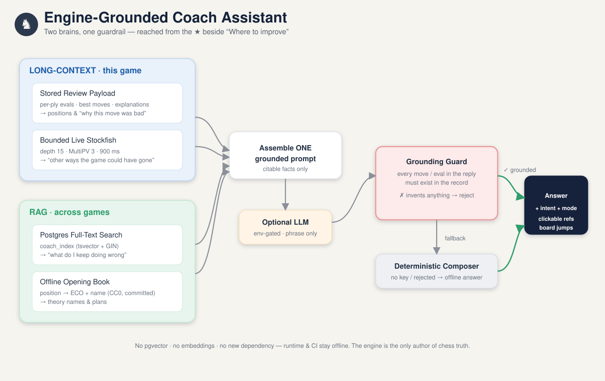
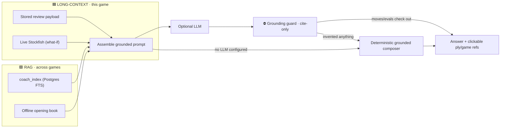

# Coach Assistant — design & build docs

> A conversational, **engine-grounded** coach inside the game review, reached from
> the ⭐ (star) toggle at the left of **"Where to improve"**. It talks about the
> position on the board, the best way to proceed, other ways the game could have
> gone, and — across a player's history — *what they keep doing wrong*.
>
> Two complementary brains, one guardrail:
> **Long-context** answers about *this* game · **RAG** answers about *all your games*.

This folder is the single home for everything about that idea: what it is, how it
is built, the phased plan, and a **living checklist** that flips to ✅ as each piece
ships. The code will live in `app/ai/` (sub-packages `longcontext/` and `rag/`);
this `app/ai/docs/` folder is the documentation beside it.

---

## 🧭 Start here

| Doc | Read it to… |
|-----|-------------|
| **[architecture.md](./architecture.md)** | Understand the two scopes, the pipeline, the grounding guardrail, and the folder layout. |
| **[plan.md](./plan.md)** | Follow the decision-complete, phased build plan (backend → RAG → frontend → docs/gates). |
| **[checklist.md](./checklist.md)** | Track implementation status. Tick a box **only** when its acceptance criteria pass and the gates run. |

---

## 🌟 The one-sentence idea

You finish a game, open **Review**, hit the ⭐ next to *Where to improve*, and ask —
*"why was 13.Be2 bad?", "what should I play here?", "how else could this have gone?",
"what do I keep messing up in the Sicilian?"* — and get an answer that **only ever
quotes moves and evaluations the Stockfish engine actually produced for your game**,
never an invented line.

## 🧩 The mental model

The **two halves answer different questions**, and both feed one grounded context
that a language model may rephrase — or a deterministic composer renders verbatim
when no model is configured (dev/CI always works offline).

## ✅ What each scope is responsible for

| Player wants to know… | Scope | Source of truth | New dependency? |
|---|---|---|---|
| "What's on the board right now?" | 🟦 Long-context | Stored review + python-chess | None |
| "What's the best move / how do I proceed?" | 🟦 Long-context | Stored best + **bounded live Stockfish** | None |
| "How else could this game have gone?" | 🟦 Long-context | Live Stockfish MultiPV | None |
| "Why was that move a mistake?" | 🟦 Long-context | Stored `explanation`/evals | None |
| "What do I keep doing wrong across games?" | 🟩 RAG | **Postgres FTS** over `coach_index` | None |
| "What's the theory / opening here?" | 🟩 RAG | Committed **offline opening book** | None |

> **Deliberately excluded:** pgvector / embeddings / any second datastore. The
> cross-game breadth is Postgres full-text search + the opening book, so runtime
> and CI stay offline with **no new dependency** and **no schema-extension dance**.
> (If semantic recall is wanted later, see *Future work* in [architecture.md](./architecture.md).)

## 🔒 The non-negotiable rule

The rest of the app already refuses to invent chess facts
(`docs/architecture.md` coaching/tactics boundaries). The coach inherits that: **a
reply is only trusted if every move/number in it appears in the retrieved record**.
A language model is permitted to *phrase* the truth, never to *author* it. No model
key ⇒ the deterministic composer answers from the same facts. This is what keeps the
feature honest *and* CI-safe.

## 🚦 Status

This is **design + documentation only** so far — the `app/ai/` package and its tests
are not yet written. See [checklist.md](./checklist.md) for the live build status.
The proposal is queued as **Phase 11 — Engine-grounded Coach Assistant (`COACH-001…`)**
in the root `PROJECT_CHECKLIST.md`.
