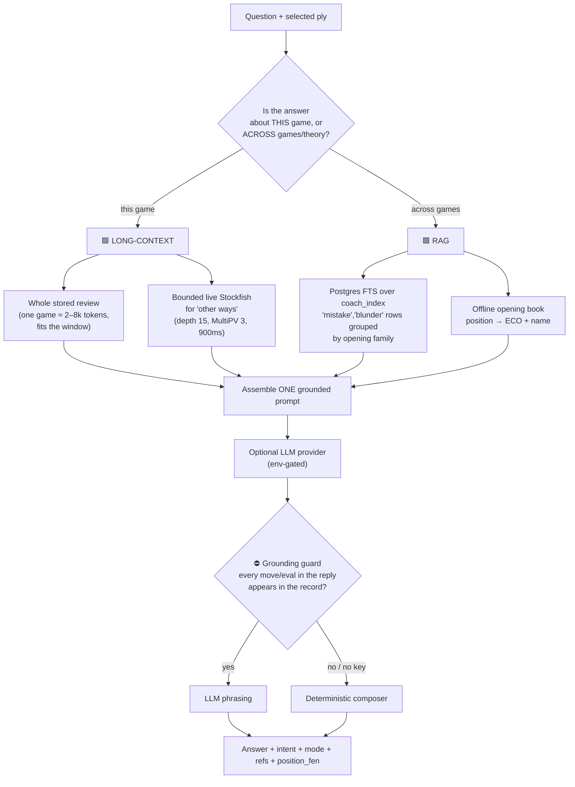
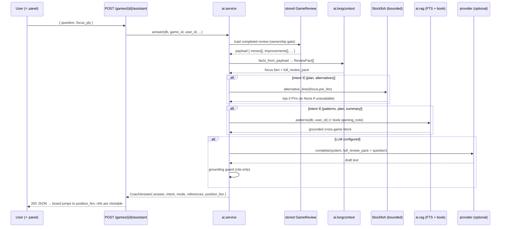
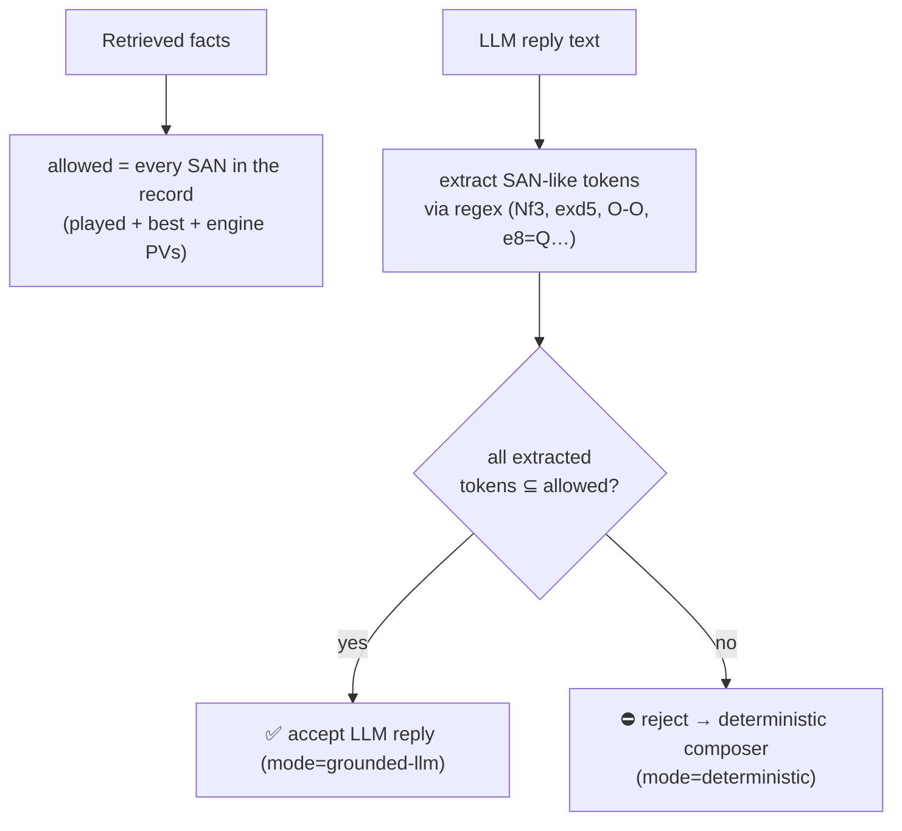
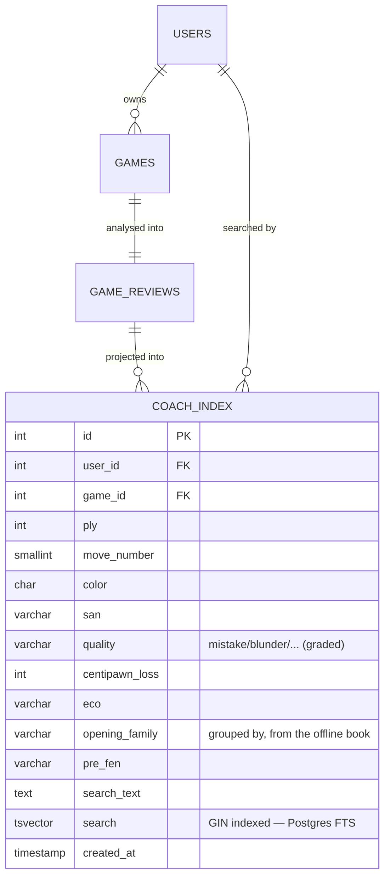
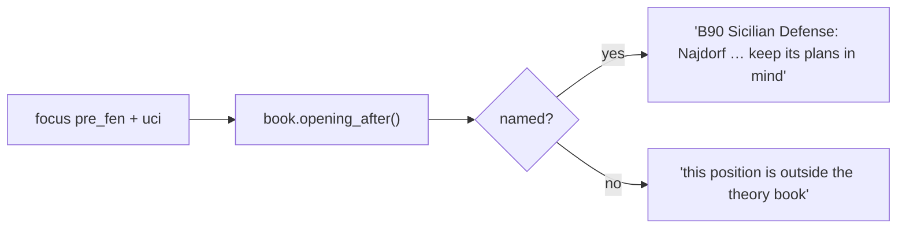

# Coach Assistant — architecture

> How the ⭐ coach works, why it is split into **long-context** and **RAG**, how it
> stays grounded (never invents chess), and exactly where every file will live.
>
> Companion to the root [`docs/architecture.md`](../../../../../docs/architecture.md)
> decision log. This feature lands as **D13**.


---

## 1. Design goals

| Goal | How it is met |
|------|---------------|
| Answer about **the position on the board** | Retrieve the stored ply's `pre_fen`; render material/eval with python-chess; return `position_fen` so the board jumps there. |
| Show **the best way to proceed** | Cite the stored `best_uci`/`best_san`, then a **bounded live Stockfish** MultiPV for the focus position. |
| Explore **other ways the game could have gone** | Live Stockfish MultiPV (`whatif`) — top-3 principal variations, each a real engine line. |
| Detect **what the player keeps doing wrong across games** | Postgres **full-text search** + aggregate over `coach_index` grouped by opening family. |
| Explain **opening theory** | The committed **offline opening book** (`app/openings/book.py`). |
| Never **invent** an eval or a move | The **grounding guard**: a model reply is accepted only if every move token appears in the retrieved facts; otherwise the deterministic composer answers. |
| Keep **runtime & CI offline**, no new dependency | FTS + book are core-Postgres/committed; the LLM is optional and env-gated; **no pgvector, no embeddings, no model in tests**. |

---

## 2. The two scopes (and why they are different tools)



**Long-context vs RAG is a "does it fit?" decision.** One game's review is small
(few thousand tokens) so the model simply *sees the whole game* — better than
stitching windows. RAG earns its keep only when the answerable set exceeds one game:
the player's **entire history** of reviews (recurring mistakes) and the **theory**
corpus (the opening book).

---

## 3. Request lifecycle



---

## 4. Module layout

```
app/ai/
├── __init__.py                  façade docstring (scope map)
├── provider.py                  optional LLM seam (OpenAI-compatible chat)
├── compose.py                   deterministic grounded answers + intent + guard
├── service.py                   orchestrator (long-context + RAG + fallback)
├── longcontext/                 🟦 scope: this game
│   ├── __init__.py
│   ├── context.py               ReviewFact, facts_from_payload, full_review_pack
│   └── whatif.py                alternative_lines() — bounded live Stockfish
├── rag/                         🟩 scope: across games + theory
│   ├── __init__.py
│   ├── models.py                CoachIndex (coach_index table; tsvector + GIN)
│   ├── index.py                 upsert_review() — project a review into the corpus
│   └── recall.py                patterns(), free_text_hits(), opening_note()
├── docs/                        ← this folder (documentation)
│   ├── README.md · architecture.md · plan.md · checklist.md
│   └── assets/                  diagrams/illustrations
└── (api glue, not under ai/)
    ├── app/api/v1/assistant.py  router: POST .../assistant, GET .../assistant/patterns
    ├── app/api/v1/schemas.py    AssistantAskRequest/Answer/Reference, CoachPattern(s)
    ├── app/main.py              include_router(assistant_router)
    ├── app/models/__init__.py   register CoachIndex
    ├── app/reviews/service.py   calls index_review_safe() after a completed review
    └── alembic/versions/xxxx    create coach_index (no extension, no vector)
```

### Responsibility boundaries (mirrors the root architecture table)

| Module | Owns | Must NOT own |
|--------|------|--------------|
| `ai.longcontext` | Read the stored review into citable facts; the whole-game prompt pack; a single bounded live-engine call | Re-analysing the whole game; writing the review; inventing evals |
| `ai.rag` | The rebuildable `coach_index` FTS corpus; cross-game aggregates; offline opening naming | Running an engine; any embeddings/vector store; trusting client-supplied counts |
| `ai.provider` | One HTTP call to an optional chat model, behind a Protocol | Deciding chess truth; being present in tests/CI without a key |
| `ai.compose` | Intent detection; deterministic answers; the cite-only guard | Fabricating a move/eval not in the record |
| `ai.service` | Orchestration + fallback selection; ownership/readiness gating | Owning rules or search |
| `api/v1/assistant` | Schemas, status codes, CSRF/rate-limit | Core chess logic |

---

## 5. The grounding guardrail (the heart of the design)



- **Numbers are already the engine's.** Every `eval_cp`, `centipawn_loss`, `best_san`
  in the prompt is stored/engine output; the prompt explicitly instructs *answer only
  from these*.
- **The guard is a belt-and-braces check**: any move the model names must exist in
  the record, or the whole reply is discarded in favour of the deterministic answer.
- **No key ⇒ no risk.** Dev and CI never call a model; the deterministic composer
  still answers every intent from the same facts.

---

## 6. Data model

### 6.1 The corpus source — `game_reviews.payload` (existing, read-only)
```
moves[]: ply, move_number, uci, san, pre_fen, color, quality,
         centipawn_loss, best_uci, eval_cp, eval_mate, explanation
eval_graph[], improvements[], counts{}, summary   (+ opening_name/win_pct derived on read)
```

### 6.2 The retrieval index — `coach_index` (new)



- **One row per graded ply the player owns** (their colour only).
- **`search` tsvector + GIN index** powers `websearch_to_tsquery` FTS.
- **`opening_family`/`eco`** come from the offline book, enabling "across your Sicilian games…" grouping.
- **Rebuildable mirror**: a failure to index never affects the authoritative review;
  a backfill script can reconstruct the table at any time.

---

## 7. Opening theory (offline)

The book is a committed extract of `lichess-org/chess-openings` (CC0). The coach only
reads it:



No network, no new data — `scripts/gen_opening_book.py` is the *only* thing that ever
touches the internet, per D10.

---

## 8. Configuration (env only, no secrets in code)

| Setting (in `app/core/database.py`) | Default | Purpose |
|---|---|---|
| `assistant_api_key` | `""` | Empty ⇒ no LLM; coach answers deterministically (offline). |
| `assistant_base_url` | `https://api.openai.com/v1` | Any OpenAI-compatible endpoint. |
| `assistant_model` | `gpt-4o-mini` | Chat model name. |
| `assistant_max_tokens` | `400` | Bound the reply. |
| `assistant_rate_limit_per_minute` | `20` | Per-user in-process limiter (single-replica caveat, like the lobby). |
| `coach_recall_top_k` | `6` | Cross-game FTS hits returned. |
| `coach_patterns_min` | `2` | Minimum errors before a pattern is surfaced. |

`.env.example` gains a documented, placeholder-only block.

---

## 9. API surface

| Method & path | Purpose | Modes returned |
|---|---|---|
| `POST /api/v1/games/{id}/assistant` | Long-context + (optional) RAG answer about this game | `mode ∈ {grounded-llm, deterministic}` |
| `GET /api/v1/games/{id}/assistant/patterns` | Cross-game "what do I keep doing wrong" (RAG/FTS aggregate) | — |

Both are behind the existing same-origin + session-auth dependency, and the POST
uses its own rate bucket. Errors: 404 unknown game · 409 no completed review ·
422 bad target · 429 rate-limited.

---

## 10. Why NOT pgvector (decision, this iteration)

An embeddings/vector store only pays off once the corpus is too big to scan and
needs *semantic* similarity. Here the unit is one player's own reviewed plies
(hundreds–low-thousands of rows), which FTS + a `GROUP BY` handle trivially.
Adding pgvector would mean: a new Python dep, a Postgres extension present in
every test/CI DB, a pgvector CI/compose image, and `create_all` coupling —
**costing the offline/CI guarantee the user explicitly wants to keep.** So it is
deferred, not rejected.

### Future work (kept intentionally out of scope for now)
- **Semantic recall** — embed position/review text for "positions like this one"
  (would revisit pgvector + an embedding provider, behind the same `coach_index`).
- **Async review + eval cache** (root ANL-005/008) lets `whatif` reuse cached lines.
- **Coach memory session context** — multi-turn conversation state (today it is
  one question per turn; the frontend keeps the chat history for display).
