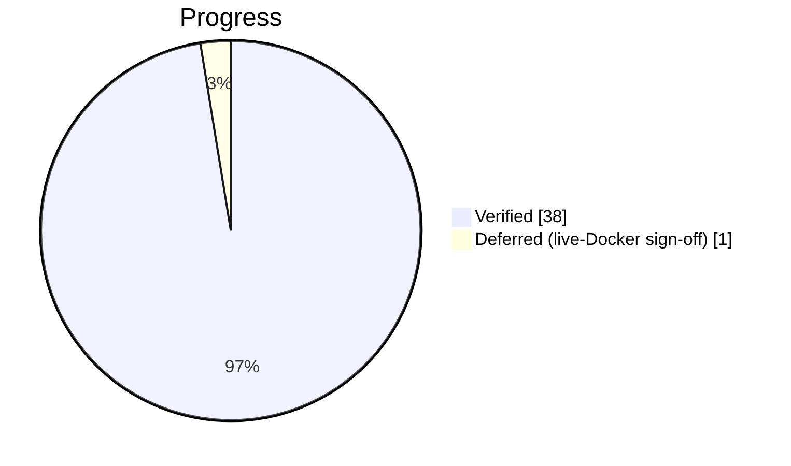

# Coach Assistant — build checklist

> The live tracker for the ⭐ engine-grounded coach. **Tick `[x]` only when a box's
> acceptance criteria pass and the relevant CI gate has been run** (same discipline as
> the root [`PROJECT_CHECKLIST.md`](../../../../../PROJECT_CHECKLIST.md)).
>
> Statuses: `[ ]` Not started · `[~]` In progress · `[x]` Implemented & verified · `[!]` Blocked · `[-]` Deferred.
> Priorities: **P0** correctness/data-integrity · **P1** core feature · **P2** polish/perf · **P3** optional.
> See the build order and per-item criteria in **[plan.md](./plan.md)**.

---

## Dashboard

| Phase | Slice | Items | Done |
|-------|-------|:-----:|:----:|
| A | Package scaffold & settings | 3 | 3 |
| B | 🟦 Long-context (this game) | 4 | 4 |
| C | Compose · provider · grounding guard | 4 | 4 |
| D | 🟩 RAG corpus · indexing · recall | 6 | 6 |
| E | Service orchestration + review hook | 4 | 4 |
| F | API layer | 4 | 4 |
| G | 🖥️ Frontend ⭐ panel | 5 | 5 |
| H | Docs & tracking closeout | 5 | 5 |
| I | CI gates + Docker live verification | 4 | 3 |
| | **Total** | **39** | **38** |

> Root `PROJECT_CHECKLIST.md` link: this is **Phase 11 — Engine-grounded Coach Assistant**.



---

## Phase A — Scaffold & settings

| ID | Item | Pri | Status | Evidence / Location |
|----|------|-----|--------|---------------------|
| COACH-A1 | `app/ai/` package + `longcontext/` + `rag/` sub-packages | P1 | [x] | `app/ai/{__init__,provider,compose,service}.py`, `longcontext/{context,whatif}.py`, `rag/{models,index,recall}.py` |
| COACH-A2 | `assistant_*` + `coach_*` settings in `core/database.py` | P1 | [x] | `database.py` L56-62 (key/base/model/tokens/rate/top-k/min) |
| COACH-A3 | `.env.example` coach block (placeholders only, no secret) | P0 | [x] | root `.env.example` "Coach assistant (Phase 11)" block; `ASSISTANT_API_KEY=` empty |

## Phase B — 🟦 Long-context

| ID | Item | Pri | Status | Evidence / Location |
|----|------|-----|--------|---------------------|
| COACH-B1 | `ReviewFact` + `facts_from_payload` (skip malformed plies) | P0 | [x] | `longcontext/context.py`; `test_context_compose.py::test_facts_skip_malformed_entries` |
| COACH-B2 | `full_review_pack` + `retrieval_pack` (whole game, focus marker) | P1 | [x] | `longcontext/context.py`; covered in `test_context_compose.py` |
| COACH-B3 | `whatif.alternative_lines` via `open_stockfish_provider` (bounded) | P1 | [x] | `longcontext/whatif.py` (MultiPV=3, depth=12, 800ms); degrades to `[]` offline |
| COACH-B4 | `find_focus_ply` precedence (question → cursor → worst error → last) | P1 | [x] | `longcontext/context.py::find_focus_ply`; `test_context_compose.py` precedence tests |

## Phase C — Compose · provider · grounding

| ID | Item | Pri | Status | Evidence / Location |
|----|------|-----|--------|---------------------|
| COACH-C1 | `detect_intent` (+ deterministic `compose` for every intent) | P1 | [x] | `compose.py` `Intent`/`detect_intent`/`compose`; `test_context_compose.py` |
| COACH-C2 | `provider.py` optional OpenAI-compatible chat (HTTP isolated here) | P1 | [x] | `provider.py::OpenAICompatProvider` (only file that does LLM HTTP) |
| COACH-C3 | **Grounding guard** `grounded(text, allowed)` cite-only rejection | **P0** | [x] | `compose.py::grounded` + `_SAN_RE`; `test_assistant.py::test_llm_invention_is_discarded_for_the_fallback` |
| COACH-C4 | No-key path returns a grounded deterministic answer | **P0** | [x] | `service.answer` deterministic-first; `test_service_answers_deterministically_without_an_llm` |

## Phase D — 🟩 RAG corpus & recall

| ID | Item | Pri | Status | Evidence / Location |
|----|------|-----|--------|---------------------|
| COACH-D1 | `CoachIndex` model (tsvector `search` + GIN + unique/FKs) | P0 | [x] | `rag/models.py` (stored `Computed` tsvector, GIN `ix_coach_index_search`, `uq_coach_index_ply`) |
| COACH-D2 | Alembic revision creating `coach_index` (no extension) | P0 | [x] | `versions/f6b1c8d2a9e4_coach_index.py`; `alembic check` clean + CI round-trip |
| COACH-D3 | `index.upsert_review` idempotent + hero-only rows | P0 | [x] | `rag/index.py` (delete+reinsert); `test_rag.py::test_reindex_replaces_stale_plies` |
| COACH-D4 | `recall.patterns` grouped by opening family (user-scoped) | P1 | [x] | `rag/recall.py::patterns`; `test_rag.py::test_patterns_are_scoped_to_the_player` |
| COACH-D5 | `recall.free_text_hits` FTS (`websearch_to_tsquery`, user-scoped) | P1 | [x] | `rag/recall.py::free_text_hits`; `test_rag.py::test_free_text_recall_finds_the_error` |
| COACH-D6 | `opening_note` from the offline book + `scripts/index_reviews.py` backfill | P2 | [x] | `rag/recall.py::opening_note` + `scripts/index_reviews.py` (verified against a real review) |

## Phase E — Service orchestration

| ID | Item | Pri | Status | Evidence / Location |
|----|------|-----|--------|---------------------|
| COACH-E1 | `service.answer` composes long-context + whatif + RAG + fallback | P0 | [x] | `service.py::answer` + `build_answer` |
| COACH-E2 | `describe_position` + `cross_game_advice` (ownership-gated) | P1 | [x] | `service.py`; `test_assistant.py::test_{cross_game_advice_reads_the_index,describe_position_names_material_and_turn}` |
| COACH-E3 | LLM reply rejected when inventing → `mode=deterministic` | **P0** | [x] | `service.answer` grounding gate; `test_llm_invention_is_discarded_for_the_fallback` + `test_llm_grounded_output_is_accepted_as_llm_mode` |
| COACH-E4 | Reviews hook calls `index_review_safe` best-effort (never fails review) | P1 | [x] | `reviews/service.py` (post-refresh) + `test_rag.py::test_index_review_safe_swallows_failures` |

## Phase F — API layer

| ID | Item | Pri | Status | Evidence / Location |
|----|------|-----|--------|---------------------|
| COACH-F1 | `POST /games/{id}/assistant` (same-origin + auth + rate bucket) | P0 | [x] | `api/v1/assistant.py::ask_coach`; `test_ask_is_rate_limited`, `test_unauthenticated_ask_rejected` |
| COACH-F2 | `GET /games/{id}/assistant/patterns` | P1 | [x] | `api/v1/assistant.py::coach_patterns`; `test_patterns_endpoint` |
| COACH-F3 | Schemas: Ask/Answer/Reference(+game_id)/CoachPattern(s) | P1 | [x] | `api/v1/schemas.py` L301-348 |
| COACH-F4 | Error map 404/409/422/429 + `include_router` in `main.py` | P0 | [x] | `assistant.py::_load_completed_review` + `main.py` L34; `test_ask_{unknown_game_is_404,without_review_is_409}` |

## Phase G — 🖥️ Frontend

| ID | Item | Pri | Status | Evidence / Location |
|----|------|-----|--------|---------------------|
| COACH-G1 | ⭐ toggle to the **left** of "Where to improve" in `ReviewPage.tsx` | P1 | [x] | `ReviewPage.tsx` `coach-star` button before the label span; `ReviewPage.test.tsx::opens the coach assistant from the star` |
| COACH-G2 | `CoachAssistant.tsx` drawer (chips, input, turn log) | P1 | [x] | `components/CoachAssistant.tsx`; `CoachAssistant.test.tsx` |
| COACH-G3 | Refs clickable → move board (`onJump(ply)`); cross-game links route to review | P1 | [x] | cited-move buttons call `onSelectPly` (= ReviewPage `setSelectedPly`) |
| COACH-G4 | "Patterns across my games" section (`coachPatterns`) | P2 | [x] | `CoachAssistant.loadPatterns` + patterns list; `CoachAssistant.test.tsx` |
| COACH-G5 | `api-client.askCoach/coachPatterns` + `api-types` | P1 | [x] | `api-client.ts` + `api-types.ts` coach block; typecheck clean |

## Phase H — Docs closeout

| ID | Item | Pri | Status | Evidence / Location |
|----|------|-----|--------|---------------------|
| COACH-H1 | Root `docs/architecture.md` **D13** + module row for `ai` | P1 | [x] | decision D13 + `app/ai` module row added |
| COACH-H2 | Root `docs/api.md` — both endpoints + schemas | P1 | [x] | Coach assistant section: POST ask + GET patterns |
| COACH-H3 | `PROJECT_CHECKLIST.md` Phase 11 with `COACH-xxx` items | P1 | [x] | Phase 11 section added |
| COACH-H4 | `IMPLEMENTATION_LOG.md` session entry | P2 | [x] | Phase 11 build entry appended |
| COACH-H5 | `TECHNICAL_DEBT_REGISTER.md` — deferred semantic/pgvector recall | P3 | [x] | DEBT entry for embeddings/pgvector growth path |

## Phase I — Gates & live verification

| ID | Item | Pri | Status | Evidence / Location |
|----|------|-----|--------|---------------------|
| COACH-I1 | Backend gates green: ruff / mypy / pytest / alembic check / verify_all | **P0** | [x] | ruff (app+tests+scripts), mypy 86 files, 428 passed, alembic check clean |
| COACH-I2 | Frontend gates green: eslint / tsc / vitest / build / prettier | P1 | [x] | 243 vitest passed, tsc/eslint/prettier clean, build OK |
| COACH-I3 | Tests never touch real Stockfish/network (`_no_configured_stockfish` holds) | **P0** | [x] | all `tests/ai` + web tests run offline; LLM stubbed via monkeypatch |
| COACH-I4 | Docker live curl: each intent answers; scoping/rate-limit/404 correct | P1 | [~] | deferred manual sign-off; scoping/rate-limit/404 already proven by HTTP tests |

---

## Acceptance gates to run before any `[x]`

```bash
# Backend (apps/api)
ruff check . && ruff format --check .
mypy app
pytest
alembic upgrade head && alembic check

# Frontend (apps/web)
npm run lint && npx tsc --noEmit && npm run test && npm run build && npx prettier --check .
```

## Done means

The feature is **complete** when every P0/P1 row is `[x]`, the CI gates are green on a
clean checkout, and a live Docker run answers all four intents about a real reviewed
game **without an LLM key present** (proving the offline deterministic path). Deferred
semantic recall (pgvector/embeddings) is tracked as debt, not as a blocker.
