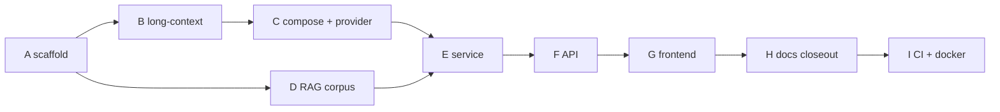

# Coach Assistant — implementation plan

> A decision-complete build plan. Each step names the file(s), the exact behaviour,
> and the acceptance test that proves it. **Start-to-finish, each phase ends green on
> the CI gates** (`ruff` / `mypy` / `pytest` / `alembic check` on the backend; `eslint`
> / `tsc` / `vitest` / `build` / `prettier` on the frontend).
>
> Track progress in **[checklist.md](./checklist.md)**. Do the phases in order — later
> phases depend on earlier ones.

---

## Guiding rules (apply to every phase)

1. **Grounded, never invented.** Any number/move the coach cites must exist in the
   stored review, the bounded live-engine result, or the offline book. The grounding
   guard enforces this for model replies.
2. **Offline & dependency-free.** No pgvector, no embeddings, no new Python package.
   The LLM is optional and env-gated; tests/CI never require a key or a real model.
3. **One Postgres, authoritative.** `coach_index` is a rebuildable *mirror*; the review
   payload stays the source of truth. Reads never re-analyse.
4. **Follow the seams already in the codebase:** engine via `app/engine/factory.open_stockfish_provider`,
   openings via `app/openings/book`, review load via `app/reviews/service`.
5. **Tests ship with each slice** — pure unit tests where possible, API tests with the
   `db`/`authed_client` fixtures, no reliance on a real Stockfish binary or network.

---

## Phase A — Package scaffold & settings

**Files**
- `app/ai/__init__.py` — façade docstring (scope map).
- `app/ai/longcontext/__init__.py`, `app/ai/rag/__init__.py`.
- `app/core/database.py` — add `assistant_*` + `coach_*` settings (§8 of architecture).
- `.env.example` — a commented, placeholder-only coach block.

**Acceptance**
- `mypy app` and `ruff check`/`format --check` pass on the new empty packages.
- `assistant_api_key` defaults to `""`; `assistant_configured()` returns `False` in CI.

---

## Phase B — 🟦 Long-context (this game)

**Files**
- `app/ai/longcontext/context.py` — `ReviewFact`, `facts_from_payload`,
  `material_imbalance`, `eval_text`, `find_focus_ply`, `retrieval_pack`, `full_review_pack`,
  `allowed_move_strings`. (Pure python-chess + text; no HTTP/DB/LLM.)
- `app/ai/longcontext/whatif.py` — `AltLine`, `alternative_lines(fen, for_white)`,
  `lines_to_text`. Uses `open_stockfish_provider(for_review=True)` + `AnalyseRequest`
  (depth 15, MultiPV 3, `max_time_ms=900`). Wrapped in `try/except → None`.

**Acceptance**
- `facts_from_payload` ignores malformed plies (missing keys → skipped, no raise).
- `find_focus_ply` precedence: explicit `move N` in the question → `focus_ply` cursor →
  worst hero error → last ply.
- `full_review_pack` emits the whole game + focus marker + whatif + recall blocks; a
  single test game renders well under the token budget.
- `alternative_lines` returns `None` when no engine is reachable (fake-binary test),
  and a real top-3 PV list when the PATH fake returns multi-MPV info.
- Unit tests: `tests/ai/test_longcontext.py`.

---

## Phase C — Optional provider + deterministic compose + grounding guard

**Files**
- `app/ai/provider.py` — `ChatProvider` Protocol, `AssistantUnavailableError`,
  `assistant_configured()`, `OpenAICompatProvider` (requests POST `/chat/completions`,
  temp 0.2, 20s timeout, robust parsing), `open_chat_provider()`. HTTP lives **only** here.
- `app/ai/compose.py` — `Intent`, `detect_intent`, `compose(intent, focus, facts,
  hero_color, lines, *, recall_block="") -> (text, refs)`; `_summary/_plan/_alternatives/
  _position/_explain`; `allowed_tokens_from`; `grounded(text, allowed)` (SAN regex subset check).

**Acceptance**
- With no provider, `compose` produces a grounded answer for every intent (this is the
  deterministic path used in CI).
- `grounded("... Ne5 ...", allowed_without_ne5)` → `False` (invented move rejected).
- `detect_intent` maps keyword sets to `plan|alternatives|patterns|summary|position|explain`;
  default is `plan`.
- `provider.complete` raises `AssistantUnavailableError` on HTTP/empty responses; never
  propagates a `requests` exception.
- Unit tests: `tests/ai/test_compose.py`, `tests/ai/test_provider.py` (mock `requests`).

---

## Phase D — 🟩 RAG corpus, indexing & recall

**Files**
- `app/ai/rag/models.py` — `CoachIndex` (tsvector `search`, GIN index,
  `uq_coach_index_ply`, FKs to `users`/`games`).
- `app/ai/rag/index.py` — `upsert_review` (delete+insert, `ON CONFLICT DO NOTHING`),
  `index_review_safe`, `indexed_count`. Opening name via `book.opening_after`.
- `app/ai/rag/recall.py` — `patterns` (GROUP BY opening_family over mistake/blunder),
  `free_text_hits` (`search @@ websearch_to_tsquery`), `opening_note`, `patterns_text`.
- `alembic/versions/xxxx_coach_index.py` — create `coach_index` + GIN + two `ix_` indexes
  + unique. **No `CREATE EXTENSION`.**
- `app/models/__init__.py` — import + register `CoachIndex`.
- `scripts/index_reviews.py` — backfill all completed reviews into the corpus.

**Acceptance**
- `alembic upgrade head && alembic check` clean against a fresh DB.
- Indexing is **idempotent**: re-running `upsert_review` for a game yields the same rows.
- A review whose hero is White produces rows only for White plies.
- `free_text_hits(user, "sicilian blunder")` returns only that user's error rows whose
  tsvector matches; other users' rows are never returned (user scoping).
- `patterns` surfaces a family only at `>= coach_patterns_min` errors.
- An indexing exception (e.g., bad payload) does **not** raise out of `index_review_safe`.
- Unit/integration tests: `tests/ai/test_rag.py`.

---

## Phase E — Service orchestration + review hook

**Files**
- `app/ai/service.py` — `CoachAnswer`; `_completed_review` (ownership + status gate);
  `ensure_review` (public gate); `build_answer(...)` (detect → focus → compose → optional
  LLM → guard → fallback); `answer(...)` (adds live `whatif` for `plan|alternatives`,
  RAG `patterns_text` for `patterns|plan|summary`); `describe_position(...)`;
  `cross_game_advice(...)`.
- `app/reviews/service.py` — after a completed review is generated/loaded, call
  `index_review_safe(db, review)` best-effort (deferred import to avoid a load cycle).

**Acceptance**
- `answer` with **no key** and **no engine** still returns a deterministic grounded
  answer citing stored facts (CI path).
- With a stub provider returning an invented move, `build_answer` falls back to
  deterministic (`mode == "deterministic"`).
- With a stub provider returning grounded text, `mode == "grounded-llm"`.
- A game with no completed review raises `ReviewNotReadyError`.
- `cross_game_advice` runs the ownership gate before searching.
- Tests: `tests/ai/test_service.py`.

---

## Phase F — API layer

**Files**
- `app/api/v1/schemas.py` — `AssistantAskRequest` (`question` 1–400, `focus_ply?`),
  `AssistantReference` (+`game_id?`), `AssistantAnswerResponse` (`answer, intent, mode,
  provider, references[], position_fen`), `CoachPattern`, `CoachPatternsResponse`.
- `app/api/v1/assistant.py` — `POST /games/{id}/assistant` (same-origin + auth + rate
  bucket), `GET /games/{id}/assistant/patterns`. Error map 404/409/422/429.
- `app/main.py` — `include_router(assistant_router, prefix=API_V1_PREFIX)`.

**Acceptance**
- API tests with `authed_client`: happy path returns 200 + `position_fen`; unknown game
  → 404; no review → 409; cross-user game → 404; over rate limit → 429.
- `GET .../patterns` returns grouped families for a user with seeded reviews.
- OpenAPI includes both endpoints (`tests/test_openapi.py` untouched assumptions hold).
- Tests: `tests/ai/test_assistant_api.py`.

---

## Phase G — 🖥️ Frontend (the ⭐ panel)

**Files**
- `web/src/lib/api-types.ts` — `AssistantAnswer`, `AssistantReference`, `CoachPattern(s)`.
- `web/src/lib/api-client.ts` — `askCoach(gameId, question, focusPly?)`,
  `coachPatterns(gameId)`.
- `web/src/components/CoachAssistant.tsx` — slide-over drawer: suggestion chips,
  input, turn log, clickable references (`onJump(ply)`), a "Patterns across my games"
  section, and cross-game links that route to `/games/:id/review`.
- `web/src/pages/ReviewPage.tsx` — ⭐ toggle button to the **left** of the "Where to
  improve" card title; opens the drawer with `heroColor`, current `selectedPly`;
  `onJump` sets `selectedPly`.
- `web/src/styles.css` — `.improve-head`, `.star-toggle(.on)`, `.coach-*` classes.

**Acceptance**
- Clicking ⭐ opens the panel; asking a question posts to the API and renders the
  answer + refs; clicking a ref moves the board (sets `selectedPly`).
- `vitest` + Testing Library: `CoachAssistant.test.tsx` mocks `api.askCoach` and
  asserts answer render + `onJump` callback; ReviewPage test toggles the panel.
- `tsc --noEmit`, `eslint`, `prettier --check`, `vite build` all pass.

---

## Phase H — Docs & tracking closeout

**Files**
- Root `docs/architecture.md` — add **D13** (engine-grounded assistant; long-context +
  FTS RAG; LLM optional with deterministic fallback; no invented evals; no pgvector this
  iteration) + a module row for `ai (app/ai)`.
- Root `docs/api.md` — document both endpoints + schemas.
- Root `PROJECT_CHECKLIST.md` — new **Phase 11** with `COACH-001…` items.
- Root `IMPLEMENTATION_LOG.md` — a session entry for the coach build.
- `TECHNICAL_DEBT_REGISTER.md` — a TD entry for the deferred semantic/pgvector recall.
- This `app/ai/docs/` set stays as the feature's own documentation.

**Acceptance**
- Every `COACH-xxx` maps to shipped code + a passing test before it is ticked `[x]`.

---

## Phase I — Full CI gate + Docker live verification

**Backend:** `ruff check`, `ruff format --check`, `mypy app`, `pytest`,
`alembic upgrade head && alembic check`, `verify_all()` (training) — all green.
**Frontend:** `eslint`, `tsc --noEmit`, `vitest`, `vite build`, `prettier --check` — green.
**Docker live curl:** rebuild `api`+`web`; register a user; play/finish a game; generate
a review; `POST .../assistant` for each intent (position/plan/alternatives/patterns) →
grounded 200s; a wrong-scope game → 404; rate-limit → 429; clean up test rows.

**Acceptance**
- Coach answers offline (no key in container) via the deterministic composer.
- No test talks to a real Stockfish or the network (per the existing `_no_configured_stockfish`
  conftest guard — the coach must respect it: `whatif` returns `None` unless a `fake_binary`
  is injected).

---

## Sequencing & dependencies

**Rough sizing:** A–F backend is the bulk; G is a self-contained UI slice; H–I are
verification. Each phase is independently mergeable behind a green gate.

## Risk & mitigation

| Risk | Mitigation |
|------|-----------|
| `whatif` makes tests depend on Stockfish | Conftest already strips the binary/key; `alternative_lines` → `None`; deterministic path uses stored best. Tests inject `fake_binary` only where they assert engine lines. |
| Model invents a move | Grounding guard rejects → deterministic fallback. |
| `coach_index` vs model/migration drift | Model + migration declared together; `alembic check` in CI. |
| tsvector/GIN unsupported on the test DB | It's **core Postgres** (not an extension) — supported on `postgres:18-alpine` and the host PG14; no `CREATE EXTENSION` needed. |
| Rate limiter is in-process | Documented single-replica caveat (same as lobby hub); fine for current deployment. |
